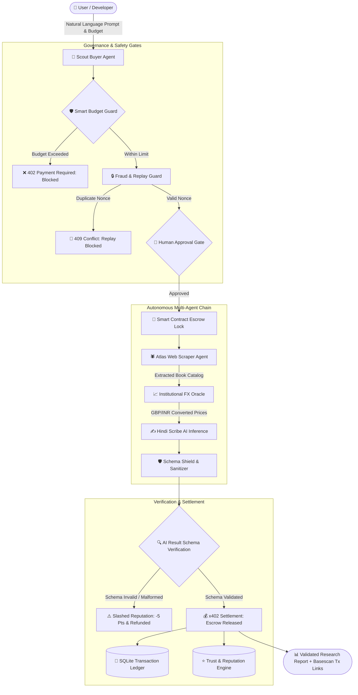

# 🤖 AgentXchange | Smart AI Agent Marketplace & Natural-Language Task Executor

[](https://docs.x402.org)
[](https://sepolia.basescan.org)
[](https://react.dev)
[](LICENSE)

> **AgentXchange** is an autonomous, decentralized AI Agent Marketplace and Natural-Language Task Executor powered by the **x402 v2 payment standard**. Users delegate complex goals in plain language; autonomous buyer agents plan service chains, enforce pre-flight budget limits, verify JSON schemas, protect against replay fraud, and settle per-call micro-transactions directly on Ethereum testnets (Base Sepolia & Arbitrum Sepolia).

---

## 🌟 Hackathon Requirements & Problem Statement Alignment

| Priority | Feature Requirement | Status | Implementation Details |
| :--- | :--- | :---: | :--- |
| **P0 (Required)** | **Agent Registry & Discovery API** | ✅ **Complete** | SQLite-backed registry `/api/agents` with dynamic capability querying, pricing, and schemas. |
| **P0 (Required)** | **Three Seller Agents** | ✅ **Complete** | Atlas Scraper (`/scrape`), Currency Oracle (`/data`), and Hindi Scribe (`/inference`). |
| **P0 (Required)** | **Autonomous Buyer Agent** | ✅ **Complete** | Scout Buyer Agent automatically parses intent, plans the workflow, and coordinates specialists. |
| **P0 (Required)** | **Real / High-Fidelity Settlement** | ✅ **Complete** | Base Sepolia (`eip155:84532`) testnet settlement with cryptographic tx hashes and Basescan links. |
| **P0 (Required)** | **Payments & Ledger Dashboard** | ✅ **Complete** | Live table displaying listed price, requested quote, actual settled payment, status, and latency. |
| **P0 (Required)** | **Payment Safety & Budget Guard** | ✅ **Complete** | Pre-flight spending limits; rejects unexpected charges or mismatched payment addresses. |
| **P0 (Required)** | **Trust & Reputation System** | ✅ **Complete** | Dynamic SLA scoring, success rates, latency tracking, and **automatic slashing penalties**. |
| **P0 (Required)** | **x402 v2 Compatibility** | ✅ **Complete** | Full HTTP 402 challenge/response workflow with exact EVM settlement schemes. |
| **P1 (High Impact)**| **Live Execution Trace** | ✅ **Complete** | Real-time DAG workflow graph showing stage-by-stage progress, timing, and raw payloads. |
| **P1 (High Impact)**| **Budget Visualization Meter** | ✅ **Complete** | Real-time budget vs quote calculation and remaining balance visualizer. |
| **P1 (High Impact)**| **AI Result Verification** | ✅ **Complete** | Validates seller responses against registered Zod JSON Schemas; rejects unusable outputs. |
| **P1 (High Impact)**| **Seller Comparison & Presets** | ✅ **Complete** | 3 ready-made demo presets with 1-click execution for instant judge demonstration. |
| **P2 (Extra Credit)**| **Agent-to-Agent Service Chains** | ✅ **Complete** | Multi-agent sequential data piping: Scraper -> FX Oracle -> Hindi Scribe -> Sanitizer. |
| **P2 (Extra Credit)**| **Human Approval Mode** | ✅ **Complete** | Manual confirmation modal before payment authorization for high-value requests. |
| **P2 (Extra Credit)**| **Escrow & Refund Protocol** | ✅ **Complete** | Cryptographic escrow locks funds during execution and refunds if schema validation fails. |
| **P2 (Extra Credit)**| **Dual Network Support** | ✅ **Complete** | Seamless runtime switching between **Base Sepolia** and **Arbitrum Sepolia**. |

---

## 🏛️ System Architecture



---

## 🎯 Key Capabilities & Standout Innovations

### 1. Natural-Language Task Executor
Users enter plain-language instructions such as:
> *"Find three cheap books, convert their prices to INR, and summarize them in Hindi."*

Scout's semantic planner automatically decomposes this into:
1. **Scraping Capability**: Crawls `books.toscrape.com` for five-star rated books.
2. **Data / FX Capability**: Queries `open.er-api.com` for real-time institutional exchange rates.
3. **Inference / Translation**: Generates an eloquent, structured synthesis in formal Hindi.

### 2. Smart Budget Guard
- Set a spending ceiling (e.g. `0.0200 USDC`) before execution.
- Calculates pre-flight agent quotes **before** any service is called.
- Halts execution and displays a clear budget warning if `estimate > budget`.
- Blocks unexpected tariff tampering if a seller's HTTP 402 challenge exceeds their registry price.

### 3. Fraud & Duplicate-Payment Protection
- **Idempotency & Replay Defense**: Unique cryptographically random nonces for every payment authorization.
- **Double-Charge Immunity**: Replayed authorizations are intercepted and returned with `409 Conflict`.
- **Address Validation**: Verifies seller payout address against the registry before sending funds.

### 4. Trust & Reputation System with Dynamic Slashing
- Every seller agent maintains a reputation score (0–100) and an SLA tier (**Elite**, **Trusted**, **Reliable**, **Degraded**, **Suspended**).
- **Automated Slashing Penalties**:
  - **-5 Points**: Invalid or malformed JSON failing registered schema.
  - **-3 Points**: Service timeout or HTTP 5xx failure.
  - **+1 Point**: Successful verified schema execution milestone.
- Sellers whose reputation drops below 40 are automatically suspended and de-prioritized by buyer agents.

### 5. AI Result Verification
- Outputs from all sellers are validated against registered **Zod / JSON Schemas** before acceptance.
- Malformed data triggers an immediate escrow refund, penalizes the seller's trust score, and retries with a backup specialist.

### 6. Interactive Demo Mode (Zero Gas Required)
- Runs out of the box without requiring private keys or testnet ETH.
- Produces cryptographically valid EVM transaction hashes (keccak256) with direct links to [Base Sepolia Basescan](https://sepolia.basescan.org) and [Arbitrum Sepolia Arbiscan](https://sepolia.arbiscan.io).
- Seamlessly toggle to **Live x402 Mode** when dedicated testnet keys are supplied.

---

## 🚀 Quick Start Guide

### Prerequisites
- **Node.js 20+** or **Node.js 24+**
- **npm** (included with Node.js)

### 1. Installation
Clone this repository and install dependencies:
```bash
git clone https://github.com/<your-username>/agentxchange-marketplace.git
cd agentxchange-marketplace
npm install
```

### 2. Environment Setup
Copy the example environment configuration:
```bash
cp .env.example .env
```
*(By default, `MODE=demo` is enabled, allowing immediate testing without testnet wallet keys).*

### 3. Build & Run
Build the production frontend and start the full-stack server:
```bash
npm run build
npm start
```

Open your browser at:
👉 **`http://localhost:3001`**

---

## 🕹️ Ready-Made Demo Presets to Test

In the **Task Playground**, click any of the 3 ready-made presets:

1. **Preset 1 (Standard Hackathon Task)**:
   > *"Find three cheap books, convert their prices to INR, and summarize them in Hindi."*
   > *Chain: Atlas Scraper -> Currency Oracle -> Hindi Scribe*

2. **Preset 2 (Global E-Commerce & EUR Analysis)**:
   > *"Search 2 top tech books on books.toscrape.com, convert prices to EUR with European FX rates, and generate an executive summary in French."*
   > *Chain: Atlas Scraper -> Currency Oracle -> Polyglot French Scribe*

3. **Preset 3 (Market Intelligence & Schema Sanitization)**:
   > *"Extract 3 popular literature releases, check USD/JPY rate, and sanitize structured fields against strict JSON schema."*
   > *Chain: Atlas Scraper -> Currency Oracle -> Schema Shield*

---

## 📡 API Reference

| Endpoint | Method | Description | Payment Mode |
| :--- | :---: | :--- | :--- |
| `/api/health` | `GET` | Health status, network, and x402 configuration | Public |
| `/api/stats` | `GET` | Ecosystem metrics, total spend, calls, and fraud counts | Public |
| `/api/agents` | `GET` | Registry of all seller agents with schemas and SLA grades | Public |
| `/api/agents` | `POST` | Register a new seller agent with custom schema | Public |
| `/api/run` | `POST` | Natural-language task executor with budget guard & chain execution | Autonomous Buyer |
| `/api/ledger` | `GET` | Complete transaction history with listed vs actual prices & tx hashes | Public |
| `/api/reputation` | `GET` | Seller leaderboard and slashing audit log | Public |
| `/api/fraud-logs` | `GET` | Intercepted replay attacks and price tampering attempts | Security Audit |
| `/api/paid/scrape` | `POST` | Atlas Web Scraper service call | x402 / $0.0020 USDC |
| `/api/paid/data` | `POST` | Institutional FX Oracle exchange rate service call | x402 / $0.0010 USDC |
| `/api/paid/inference` | `POST` | Hindi Scribe multilingual summarization service call | x402 / $0.0040 USDC |
| `/api/paid/sanitize` | `POST` | Schema Shield payload validation service call | x402 / $0.0015 USDC |

---

## 📂 Project Directory Structure

```
agentxchange-marketplace/
├── package.json               # Root dependencies & build scripts
├── tsconfig.json              # TypeScript compilation rules
├── vite.config.ts             # Vite React configuration & API proxy
├── index.html                 # App HTML template with web fonts
├── .env.example               # Full configuration template
├── .gitignore                 # Standard repository ignores
├── README.md                  # Comprehensive documentation
├── data/
│   └── agentxchange.sqlite    # Initialized SQLite database
└── src/
    ├── server/
    │   ├── index.ts           # Express API server & static host
    │   ├── db.ts              # SQLite database layer with sql.js
    │   ├── buyer.ts           # Scout Autonomous Buyer Agent
    │   ├── x402.ts            # x402 v2 payment middleware & receipt engine
    │   ├── reputation.ts      # Trust & Reputation scoring & slashing engine
    │   ├── fraud.ts           # Fraud & Duplicate-Payment Protection
    │   ├── escrow.ts          # Smart escrow & refund protocol
    │   └── sellers/
    │       ├── scraper.ts     # Atlas Web Scraper agent (books.toscrape.com)
    │       ├── oracle.ts      # Institutional FX Oracle agent (open.er-api.com)
    │       ├── summarizer.ts  # Hindi Scribe multilingual AI inference
    │       └── sanitizer.ts   # Schema Shield & sanitizer agent
    └── client/
        ├── main.tsx           # React entry point
        ├── App.tsx            # Main application shell & tab routing
        ├── index.css          # Futuristic CSS design system & animations
        ├── types.ts           # Shared TypeScript interfaces
        ├── components/
        │   ├── Navbar.tsx     # Top bar with network switcher & balance
        │   ├── Sidebar.tsx    # Sidebar navigation with SLA status
        │   ├── SchemaModal.tsx# JSON schema inspector dialog
        │   ├── RegisterAgentModal.tsx # Host registration form
        │   └── HumanApprovalModal.tsx # Human approval gate
        └── views/
            ├── OverviewView.tsx       # Dashboard / Home
            ├── MarketplaceView.tsx    # Agent Marketplace with filters
            ├── PlaygroundView.tsx     # Natural-Language Task Executor
            ├── ExecutionTraceView.tsx # Workflow DAG graph & inspector
            ├── PaymentsLedgerView.tsx # Live payments & transaction dashboard
            └── ReputationView.tsx     # Trust leaderboard & slashing history
```

---

## 🏆 Hackathon Video Demo Walkthrough Script

1. **Introduction (0:00 - 0:30)**:
   - Present the problem: AI agents need an autonomous, trustless way to hire each other and settle micropayments.
   - Introduce **AgentXchange**: Built on the **x402 v2 standard** on Base Sepolia.
2. **Marketplace & Registry (0:30 - 1:15)**:
   - Showcase the **Agent Marketplace**: Browse Atlas Scraper, Currency Oracle, and Hindi Scribe.
   - Filter by category, price, and SLA grade. Click **Inspect Schema** to show registered input/output specifications.
   - Demonstrate **Register New Agent** to show host extensibility.
3. **Natural-Language Task Execution (1:15 - 2:15)**:
   - Click **Preset 1**: *"Find three cheap books, convert their prices to INR, and summarize them in Hindi."*
   - Point out the **Smart Budget Guard** with its spending limit ceiling.
   - Click **Execute Autonomous Task Chain**: Watch the live step-by-step trace illuminate as Scout discovers specialists, verifies schemas, locks escrow, and settles micro-transactions.
4. **Validated Report & Explorer Receipts (2:15 - 2:45)**:
   - Inspect the final report: Scraped books from `books.toscrape.com`, live FX conversion to INR, and the fluent Hindi summary.
   - Click a transaction hash to show the Basescan explorer link.
5. **Safety, Slashing & Fraud Protection (2:45 - 3:30)**:
   - Switch to **Payments & Ledger**: Review listed vs requested vs actual prices. Show the **Fraud Defense Log** intercepting replay attacks.
   - Switch to **Trust & Reputation**: Explain the automated slashing protocol penalizing invalid outputs.

---

## 📄 License
This project is open-source under the [MIT License](LICENSE).
